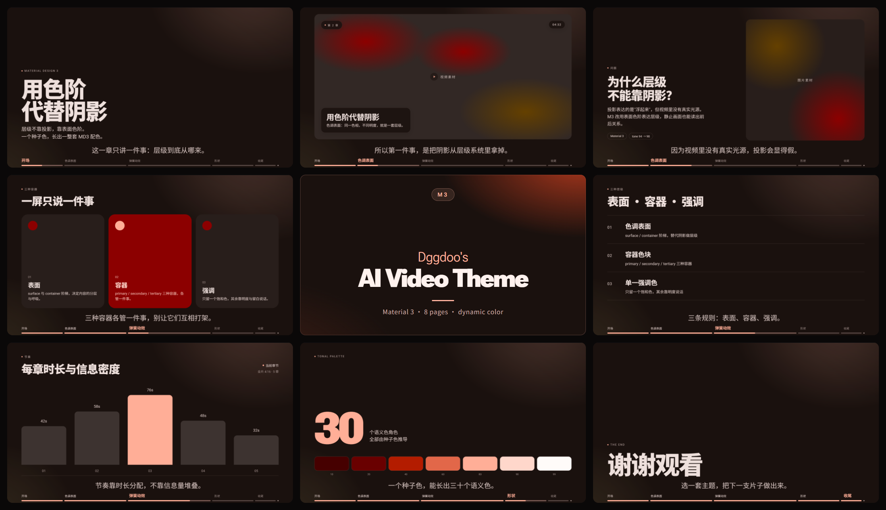

# Dggdoo's AI Video Theme



<sub>示例主题 `m3-expressive-dark` · 8 种页面：封面 / 媒体页 / 图文页 / 卡片页 / 递进页 / 图表页 / 数据页 / 尾页</sub>

给 [`web-video-presentation`](https://github.com/ConardLi/garden-skills) skill 用的
Material Design 3 视频主题。

**动态取色**：每套只有一个 `--seed`，改这一个值，整套 MD3 色调板与 30 个
语义色角色自动重算，纯 CSS，无运行时依赖。

## 六套

| id | 明暗 | 默认种子 | 性格 |
|---|---|---|---|
| `m3-tonal-spot` | 浅 | `#6750a4` | Material You 标准：色调表面、16px 圆角、无装饰 |
| `m3-tonal-dark` | 深 | `#6750a4` | 近黑表面 + 主色光晕，暗场录制 |
| `m3-vibrant` | 浅 | `#00696e` | 高饱和容器、24px 圆角、双色柔光斑 |
| `m3-expressive` | 浅 | `#e8542f` | 36px 圆角、800 字重、弹簧回弹 |
| `m3-expressive-dark` | 深 | `#e8542f` | 黑底高饱和、44px 圆角、光池 |
| `m3-quiet` | 浅 | `#3f5d53` | 低饱和、大留白、300 字重 |

## 安装

```bash
SKILL=~/xxxx/skills/web-video-presentation
cp -r themes/m3-* "$SKILL/themes/"
cat fonts-append.css >> "$SKILL/templates/src/styles/fonts.css"
```

## 用

```bash
bash "$SKILL/scripts/scaffold.sh" ./presentation --theme=m3-expressive
```

换主色 —— 改 `presentation/src/styles/tokens.css` 顶部一行：

```css
--seed: #00639b;
```

## 文件

| 文件 | 说明 |
|---|---|
| `INSTALL.md` | 完整安装（含底部进度条组件） |
| `DESIGN.md` | token 契约 / 动效规范 / 章节写作配方 |
| `preview.html` | 可交互预览：8 种页面 × 6 套，可改种子色 |

浏览器要求 Chrome / Edge 111+（`oklch(from …)`）。旧浏览器自动回退静态色调板。

## 特别感谢
DeepSeek V4.1 Flash